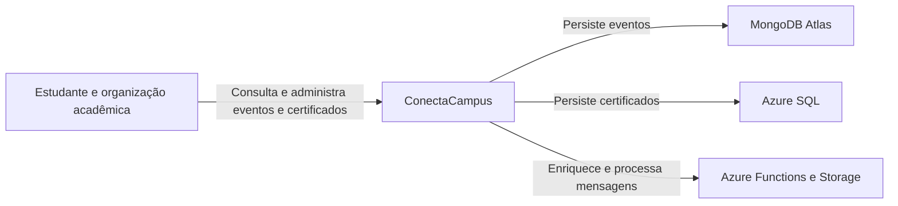
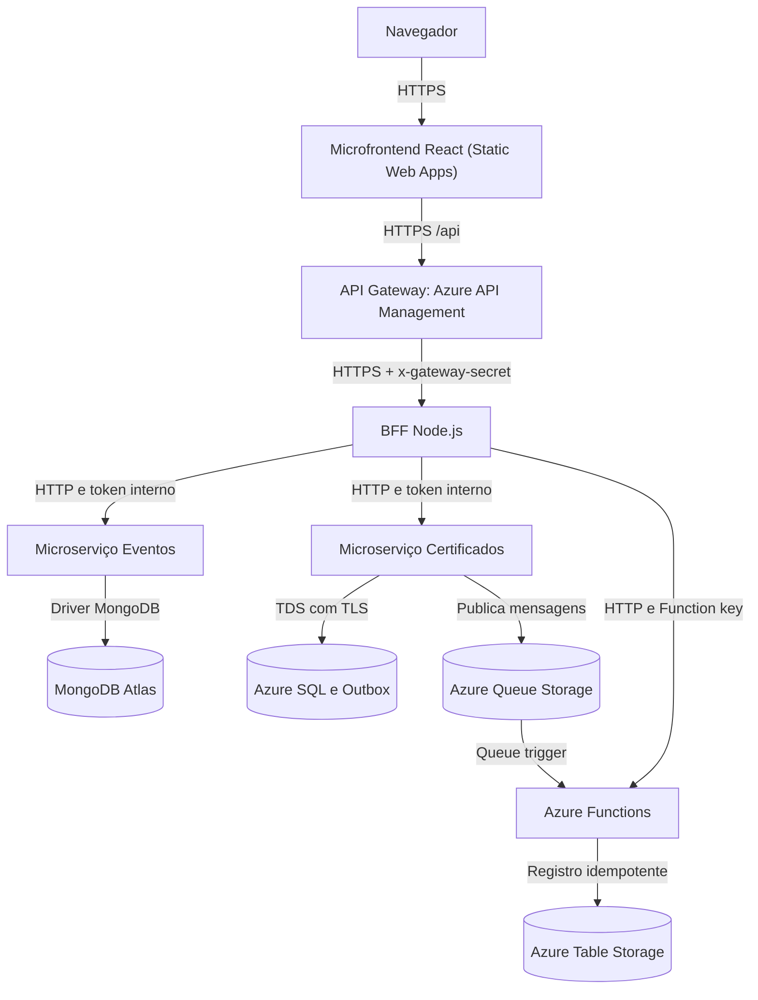
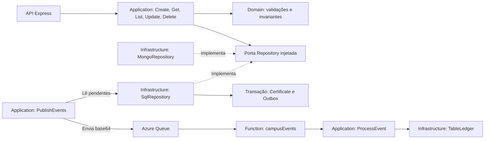

# C4 do ConectaCampus

## Nível 1: contexto

## Nível 2: containers

## Nível 3: componentes

As portas são contratos de objetos injetados em JavaScript. Eventos e certificados têm repositórios, processos e bancos próprios. O BFF não importa código desses serviços. O API Management é a única entrada para a API na nuvem, e o BFF só responde quando recebe o segredo que o gateway injeta. No Compose local, o Nginx faz esse papel.
