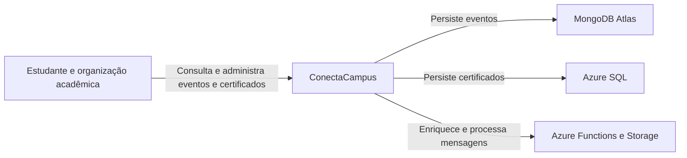
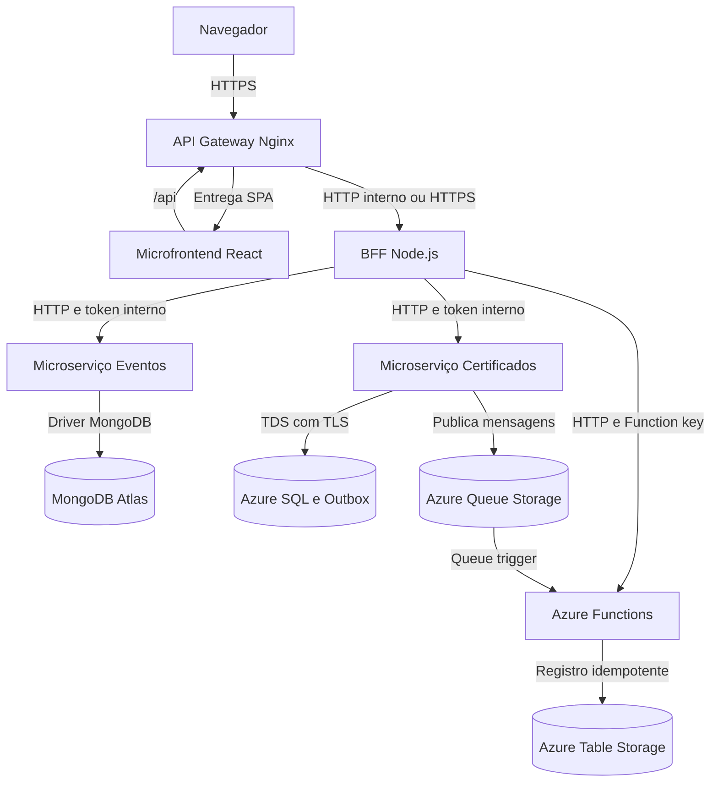
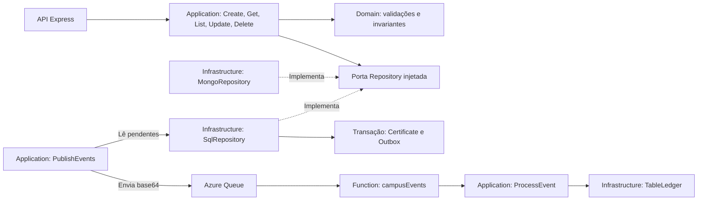

# C4 do ConectaCampus

## Nível 1: contexto

## Nível 2: containers

## Nível 3: componentes

As portas são contratos de objetos injetados em JavaScript. Eventos e certificados têm repositórios, processos e bancos próprios. O BFF não importa código desses serviços. O gateway é a única entrada pública dos containers na configuração Azure.
